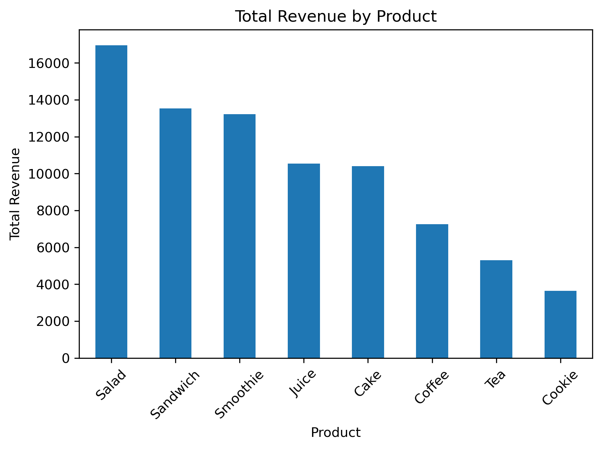
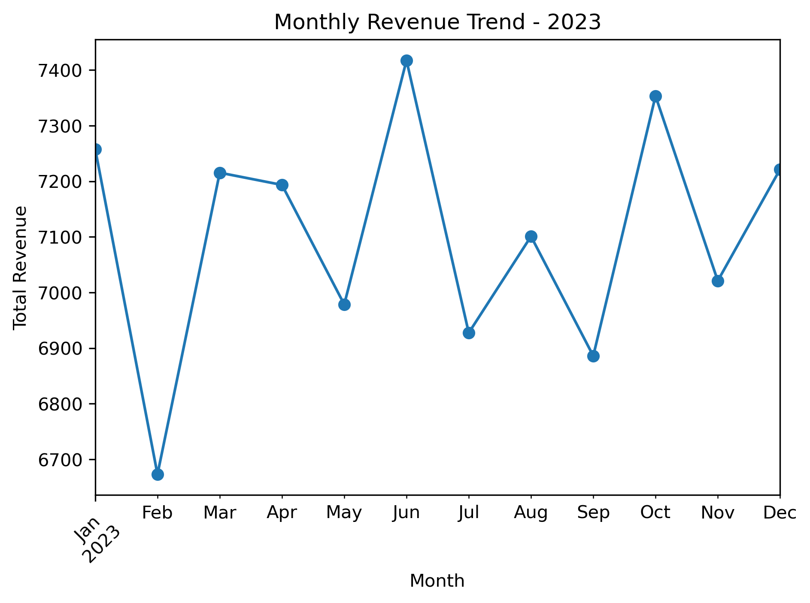
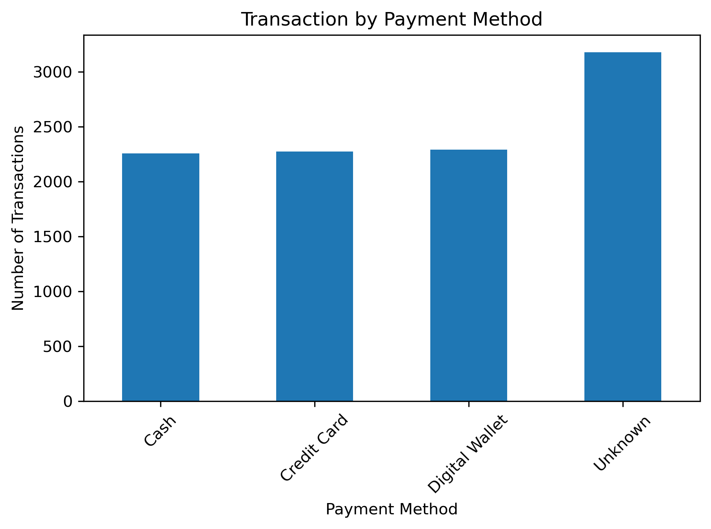
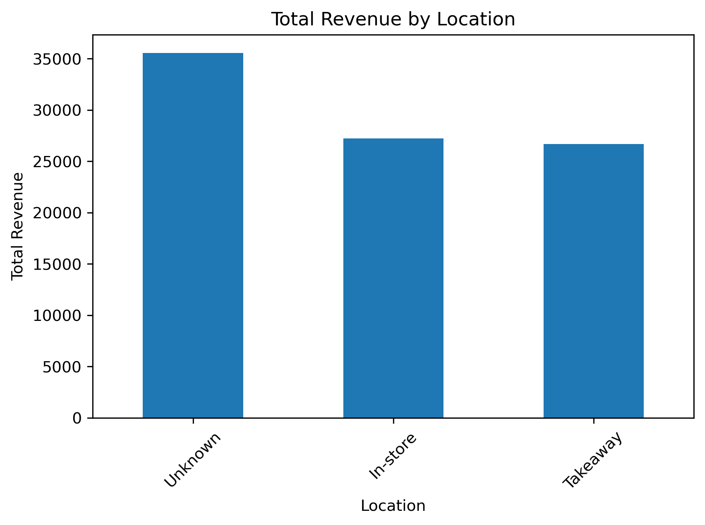
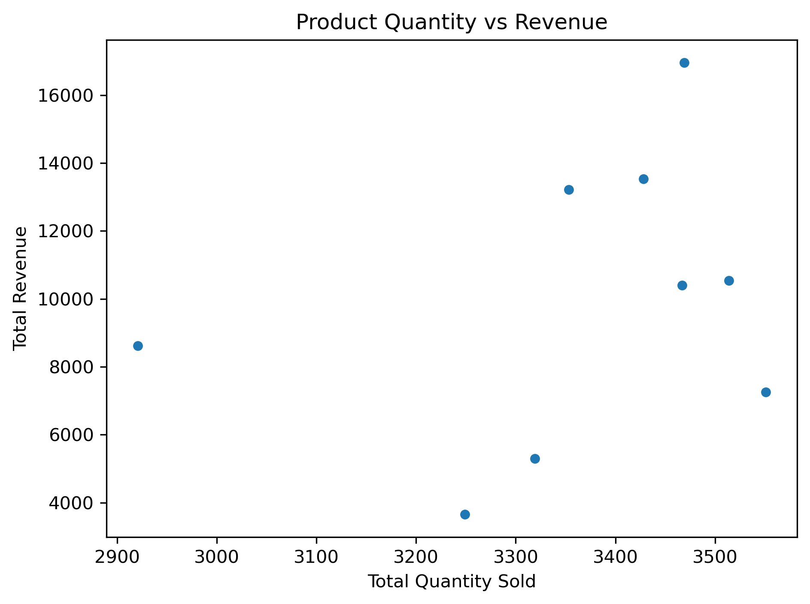

# Cafe Sales Analysis

## Project Overview
This project analyzes cafe sales transaction data using Python, Pandas, and Matplotlib. The objective is to examine product performance, monthly revenue trends, payment methods, and sales locations through exploratory data analysis and visualization.

## Dataset Overview
- Total Records: 10,000
- Total Columns: 8
- Dataset Period: January 2023 – December 2023

## Technologies Used
- Python
- Pandas
- Matplotlib
- Jupyter Notebook

## Project Workflow
1. Data Understanding
2. Data Cleaning and Preprocessing
3. Exploratory Data Analysis (EDA)
4. Data Visualization
5. Business Insights
6. Conclusion
   
**Project Resources:**
- [View Jupyter Notebook](Cafe-Sales-Analysis-.ipynb)

## Key Findings
- Coffee recorded the highest quantity sold (3,551 units).
- Salad generated the highest known-product revenue (16,959).
- June recorded the highest monthly revenue (7,417.5).
- October recorded the highest transaction count (838).
- Digital Wallet was the most frequently recorded known payment method (2,291 transactions).
- In-store revenue (27,223) was slightly higher than Takeaway revenue (26,686.5).

## Visualizations

### 1. Revenue by Product

### 2. Monthly Revenue

### 3. Payment Methods

### 4. Revenue by Location

### 5. Product Quantity vs Revenue

## Data Quality Limitations
- 969 Unknown product records (9.69%).
- 3,178 Unknown payment method records (31.78%).
- 3,961 Unknown location records (39.61%).
- 460 transactions have missing dates (4.6%).
- Product costs are unavailable, so profit cannot be calculated.

## Conclusion
This project provided practical experience in data cleaning, exploratory data analysis, visualization, and interpreting business transaction data using Python.

## Author
Vamsi P
